

Every year Year 12 school leavers from around South Australia head to Victor Harbor for Schoolies week, ready to party.<button class="cite-btn" aria-label="More info"></button>Schoolies is the Australian tradition of Year 12 school leavers celebrating the end of school with a week away, in late November. Victor Harbor is one of South Australia's favourite spots for it.<a href="https://en.wikipedia.org/wiki/Schoolies" target="_blank" rel="noopener">Wikipedia: Schoolies</a> And every year the town's community Facebook groups fill up with doorbell-camera and dashcam footage: a blurry teenager rings a doorbell at 11 pm, then legs it across the front lawn. The comments roll in, somewhere between "someone ring the police" and "harmless fun, we all did it".

So I made a game about it.

<figure class="sm-fig">
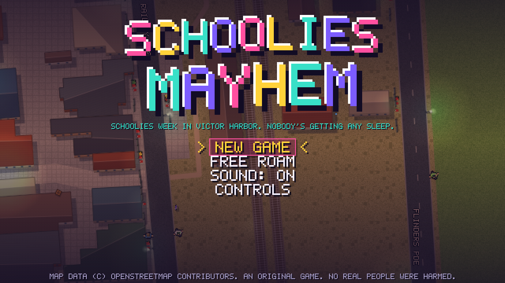
<figcaption>The title screen, over Railway Terrace at dusk.</figcaption>
</figure>

<a class="sm-play" href="https://br3nt.github.io/schoolies-mayhem/" target="_blank" rel="noopener">▶ Play Schoolies Mayhem →</a>

## How this happened

A few things converged at once.

It's Schoolies week. The schoolies are in town and the community pages are lively.

I was deep in something serious. The council's draft Victor Harbor Integrated Transport Strategy is out for comment (a one-way loop around the town centre, 30 km/h streets, new traffic signals), and before writing my submission I built [an independent traffic simulation](https://br3nt.github.io/victor-harbor-roads/) of it to see how it would play out. ([My submission is here](https://br3nt.github.io/victor-harbor-roads/submission/index.html), if you're curious.) So I had every road, roundabout and building in Victor Harbor loaded up on my screen.

Meanwhile, my husband was on the couch playing the new Grand Theft Auto 6.

Then he sent me a link to a local post of a ding-dong-ditch caught on a doorbell cam, and the comments were hilarious.

So naturally my brain went: how cool would a Grand Theft Auto-style scenario be for Victor Harbor's Schoolies week?<button class="cite-btn" aria-label="More info"></button>The very first Grand Theft Auto (1997) was a top-down game: you looked straight down on the city, long before the series went 3D. That's the look Schoolies Mayhem borrows (the game itself is all original).<a href="https://en.wikipedia.org/wiki/Grand_Theft_Auto_(video_game)" target="_blank" rel="noopener">Wikipedia: Grand Theft Auto (1997)</a><a href="https://playclassic.games/games/action-adventure-dos-games-online/play-grand-theft-auto-online" target="_blank" rel="noopener">Play the original in your browser (playclassic.games)</a>

I went with the old top-down look because I love those retro PC games from the Disk Operating System (<abbr title="Disk Operating System">DOS</abbr>) days: chunky pixels, a camera looking straight down, and a whole town to cause trouble in.

## The game

*Schoolies Mayhem* is a top-down pixel-art caper set in the real streets of Victor Harbor, built from OpenStreetMap data<button class="cite-btn" aria-label="More info"></button>OpenStreetMap is the free, volunteer-built map of the world. Every road, roundabout and building outline in the game comes from it.<a href="https://www.openstreetmap.org/" target="_blank" rel="noopener">openstreetmap.org</a>. The roads, the roundabouts and about 11,800 building outlines are where they are in real life. So are the causeway to Granite Island, the Bluff, the horse tram and the Cockle Train. Encounter Bay, where Flinders and Baudin bumped into each other in 1802, now has a different kind of encounter at 11 pm on a Thursday.<button class="cite-btn" aria-label="More info"></button>A little local history. The horse-drawn tram runs 3.1 km to Granite Island, much of it along a 630 m causeway, and is one of very few horse trams still in public service anywhere. The Cockle Train is SteamRanger's heritage train along the coast between Goolwa and Victor Harbor (about 21 km), on a line that began in 1854 as South Australia's first railway. And in 1802 the explorers Matthew Flinders (HMS Investigator) and Nicolas Baudin (Le Géographe) met here by surprise, so Flinders named it Encounter Bay.<a href="https://en.wikipedia.org/wiki/Victor_Harbor_Horse_Drawn_Tram" target="_blank" rel="noopener">Wikipedia: Victor Harbor Horse Drawn Tram</a><a href="https://en.wikipedia.org/wiki/SteamRanger" target="_blank" rel="noopener">Wikipedia: SteamRanger (the Cockle Train)</a><a href="https://en.wikipedia.org/wiki/Victor_Harbor_railway_line" target="_blank" rel="noopener">Wikipedia: Victor Harbor railway line</a><a href="https://en.wikipedia.org/wiki/Encounter_Bay" target="_blank" rel="noopener">Wikipedia: Encounter Bay</a>

The town cycles through day, dusk and night, with street lights, headlights and sea fog after 10.

The schoolies have arrived ready to party.The locals are frustrated.The police are on high alert.

You pick a side:

- **Jaz, the schoolie.** Ding-dong-ditch the town, borrow the horse tram, ride the Cockle Train and become a Schoolies legend.
- **Merv, the gopher grump.** 81 years young, one mobility scooter, zero patience. Delivers strongly worded letters, shuts down backyard doofs, and parks a B-double where it hurts.
- **Constable Kev.** Senior constable at the little Victor Harbor station. Pulls over gophers holding up traffic, chases ding-dong-ditchers down on foot, stops hoons. He gets a siren, spikes, backup and cuffs.

<figure class="sm-fig">
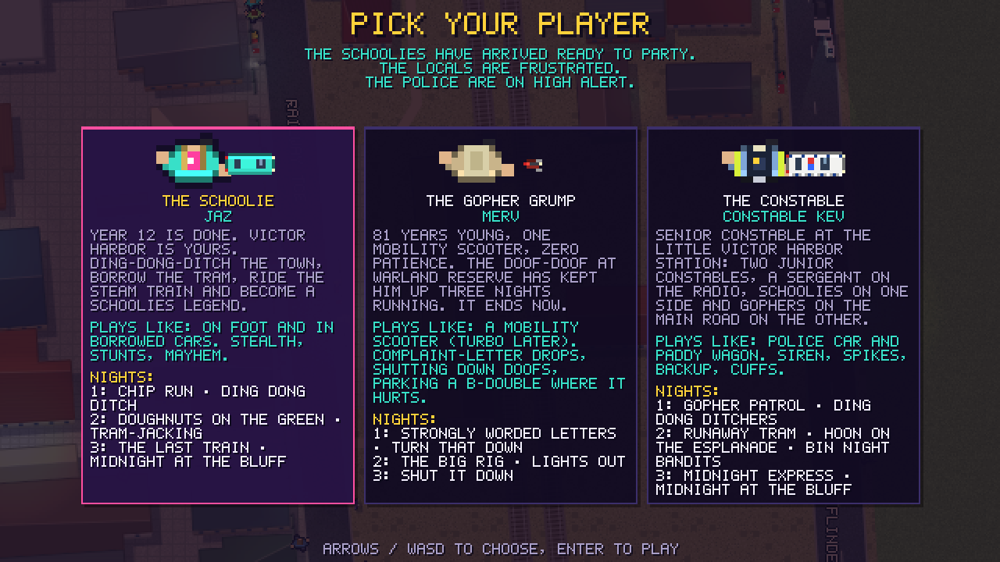
<figcaption>Three nights of jobs each. Merv's include "Strongly Worded Letters" and "Turn That Down".</figcaption>
</figure>

## Caught on the doorbell cam

The doorbell cameras made it in. Some houses have a little blinking blue light by the door. Get caught on one and your clip goes up on *Victor Harbor Locals Talk*, an invented community page, and the comments start rolling in. Then the porch light comes on and a resident comes out with a torch, and you'd better be hidden and keeping very still.

<figure class="sm-fig">

  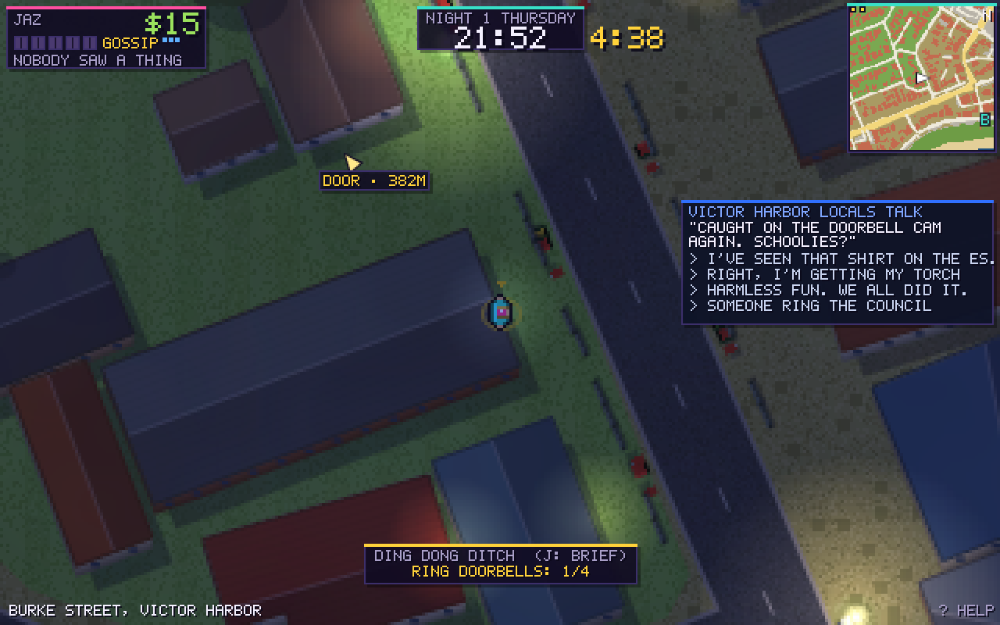
  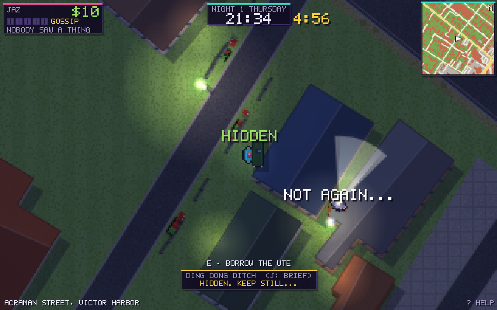

<figcaption>Left: posted to Victor Harbor Locals Talk. Right: hiding from the torch.</figcaption>
</figure>

## Borrowing things

You can borrow most things with wheels. Cars, bikes, the horse tram across the causeway and the Cockle Train to the end of the line. The game is polite about it.

<figure class="sm-fig">
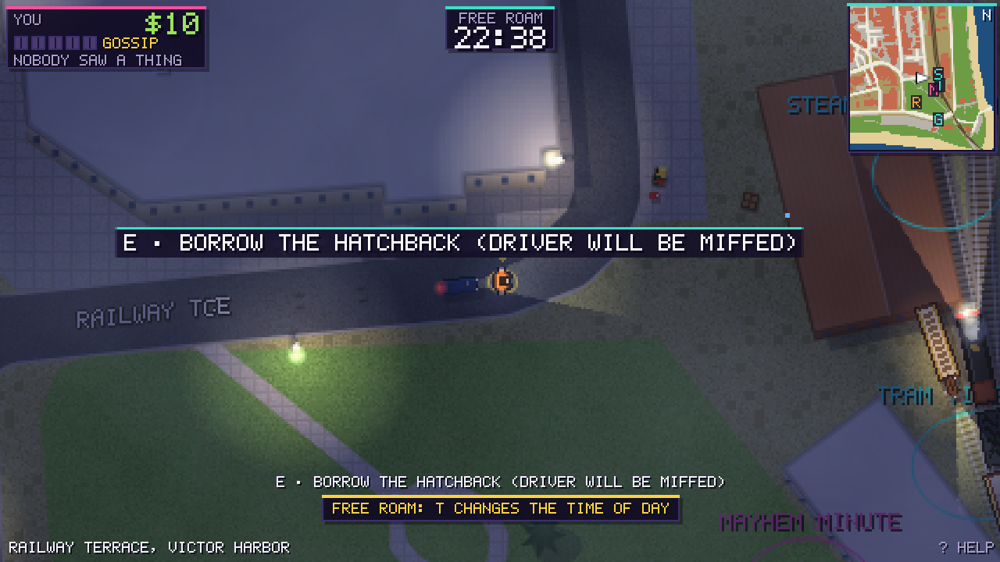
<figcaption>Free Roam, late. The driver will be miffed.</figcaption>
</figure>

<figure class="sm-fig">

  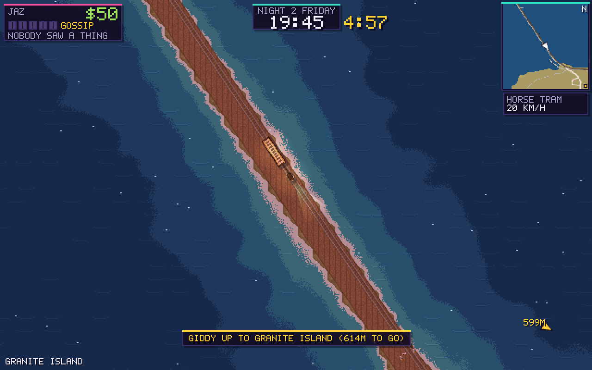
  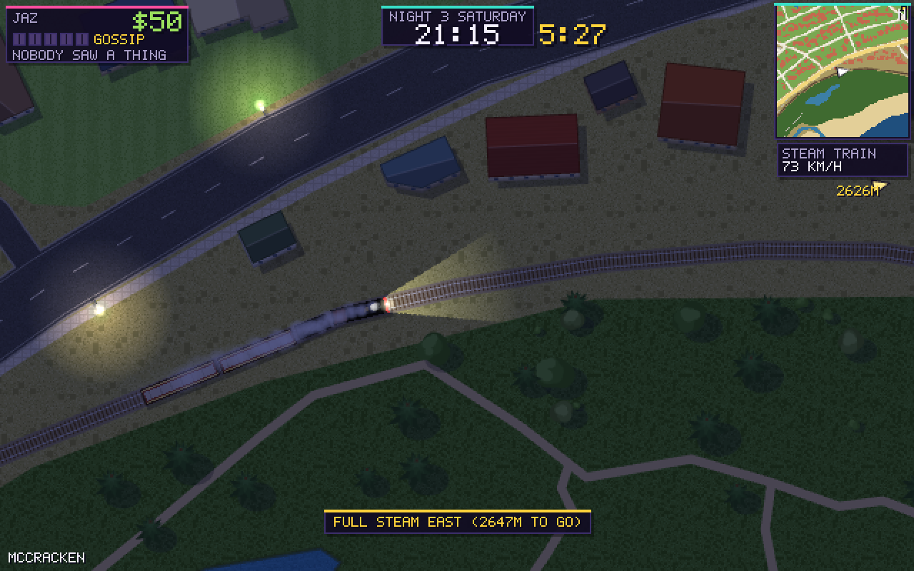

<figcaption>Giddy up to Granite Island, and full steam east.</figcaption>
</figure>

## And then the police turn up

Make enough noise and the gossip meter fills, the whole town knows, and the police come. Chases, roadblocks, spike strips, a helicopter, and if they catch you, a ride in the paddy wagon up to the lock-up, The Big House on the Hill.

<figure class="sm-fig">

  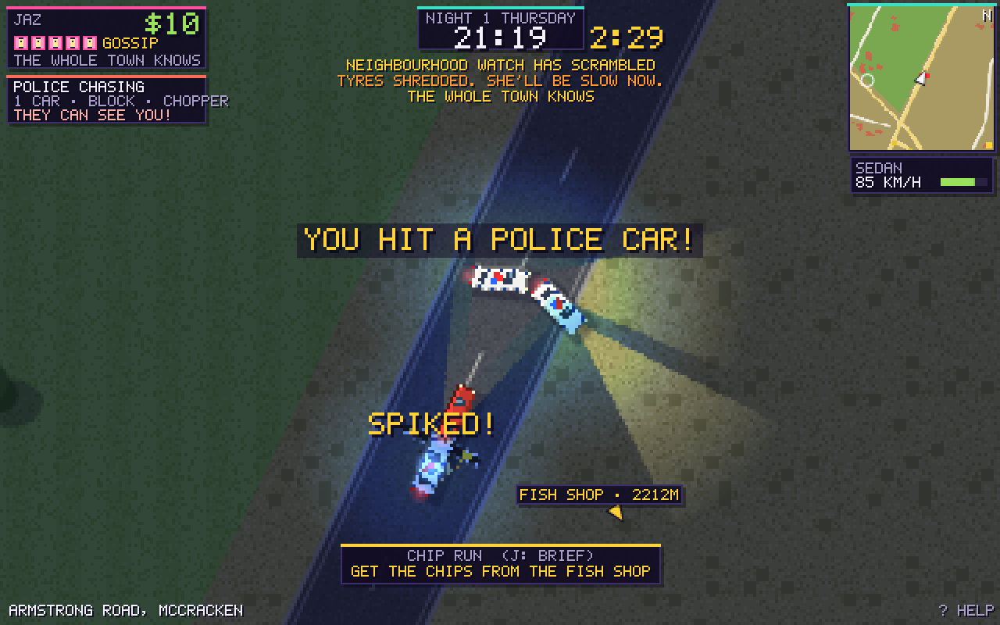
  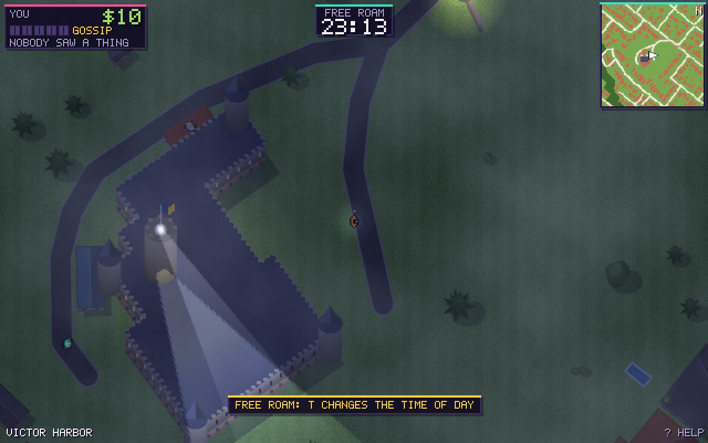

<figcaption>Spiked at a roadblock, and The Big House on the Hill.</figcaption>
</figure>

On the other side of the law, Kev gets the siren:

<figure class="sm-fig">
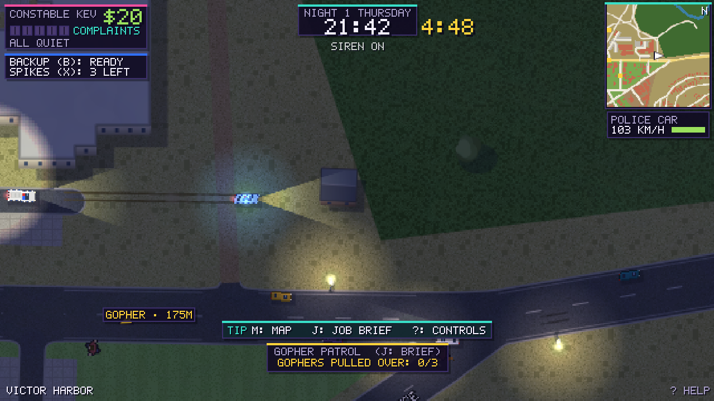
<figcaption>Gopher Patrol: three gophers holding up traffic, zero sympathy.</figcaption>
</figure>

And Merv has a party at Warland Reserve to shut down, one speaker and inflatable flamingo at a time:

<figure class="sm-fig">
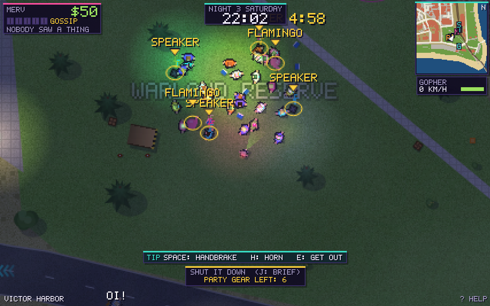
<figcaption>Night 3. It ends now.</figcaption>
</figure>

There are loot crates around town, boats and jet skis off the jetty, a water race, bicycle motocross (<abbr title="bicycle motocross">BMX</abbr>) at the skate park, hoops, lawn bowls with the locals, and a fireworks finale on Jaz's last night. Proper original music is coming soon.

Names have been changed to protect the identities and reputations of those involved. Merv insisted. Any resemblance to real gophers, living or dead, is purely coincidental.

## The vibe

I wanted this to feel like Schoolies week looks from the outside: chaotic, a bit silly, and over by Sunday. Surface-level fun, tongue firmly in cheek, and nobody actually gets hurt.

So the Grand Theft Auto bits got swapped out. There are no weapons in the game. Getting caught means a tackle, a struggle to wriggle free, and if you lose, cuffs and the paddy wagon. The police stop you with sirens, roadblocks, spike strips and the odd nudge from behind to spin you out. The mayhem is wheelie bins, letterboxes, Colorbond fences and the occasional flattened street light. Pedestrians always manage to jump out of the way, every single time.

That also meant some trade-offs. My first idea for Jaz was the classic schoolies quest: score a fake <abbr title="identification">ID</abbr> and talk your way into the local bottle-o. It fits the setting, but a game about real Victor Harbor and real Schoolies week shouldn't be a how-to for underage drinking. So that became two new jobs with the same party energy:
- hiring the sound system, lights and a giant inflatable for a party in the park (the hire form needs someone over 18 to sign);
- getting past the bouncer at an 18+ beach gig.

You still get the same tricks: sweet-talk the counter, borrow a lookalike cousin's licence (after you get their ute back from the impound yard and past its dogs), or turn up in a wig, a scarf and an old-timey hat with a walking stick. Same mischief, no booze. Those two are coming in an update soon.

## How I made it

As with [flOw](), Claude did most of the typing. My part is the ideas, the taste, and a lot of playing.

It always starts with a massive brain dump: every idea I have, however half-formed, plus links to anything I think is relevant. Claude organises that mess into some kind of structure, and then I let it go nuts on a first version with very little guidance. I find it much easier to riff on something I can actually play than on a plan.

Then the loop starts. I play big chunks of the game and take notes and screenshots as I go: what I like, what I don't, what's broken, what could be funnier. Playing always gives me a tonne more ideas, so that becomes another brain dump, and around we go until I'm happy. Ding-dong-ditching started out far too easy to get away with, for example. A few laps later, residents come out with torches, and couples split up to search and call each other over.

Sometimes I don't know how something should be done, only the effect I want. So I describe that, again with links and pictures, and ask Claude to brainstorm with me. More often than not we land on something good, like the party-gear and beach-gig jobs that replaced the fake <abbr title="identification">ID</abbr> idea. But not always.

Behind the scenes, Claude splits the work across a team of subagents, each building its own piece in its own copy of the code. Every job in the game gets played through automatically, using only key presses the way you would, so a new change that breaks an old job gets caught before it goes live. Mostly.

### Under the hood

It's very low-tech: no game engine, no framework, no build step. No 3D models, no image files for the characters, and no audio files. The whole town is built from about 20 MB of OpenStreetMap data and a lot of JavaScript.

**The game itself**

- **Plain JavaScript:** about 10,000 lines across 34 script files, loaded straight into the page.
- **<abbr title="HyperText Markup Language">HTML</abbr>5 Canvas 2D** for all the drawing: the map, the lighting, the night glow and the heads-up display.
- **Pixel art drawn in code.** There are no image files for the characters, cars or props: every sprite is generated when the game starts ([`js/sprites.js`](https://github.com/br3nt/schoolies-mayhem/blob/main/js/sprites.js)). The only images are two ground textures baked from the map.
- **Sound and music made in the browser** with the Web Audio <abbr title="application programming interface">API</abbr> ([`js/audio.js`](https://github.com/br3nt/schoolies-mayhem/blob/main/js/audio.js)). Every engine note, siren and doorbell is generated by code as you play.
- **Saves in your browser's localStorage:** your progress, records, outfits and settings. No accounts, no server.

**The map**

- **OpenStreetMap:** a raw extract of Victor Harbor's roads, buildings, rail lines, parks, coastline and named places, about 20 MB, downloaded with an Overpass query.
- **Node.js scripts** ([`tools/build_map.mjs`](https://github.com/br3nt/schoolies-mayhem/blob/main/tools/build_map.mjs) and `bake_slots.mjs`) turn that into a compact `map.json` plus the ground textures. They also work out every spot where something is allowed to appear, checked so nothing starts inside a building or in the sea.

**Testing**

- **Me, playing it.** The most important test. I play big chunks of every round on my laptop and my phone, and send back notes and screenshots: what's fun, what's broken, what's confusing ("I can't work out how to run"). That feedback drives the next round.
- **Test players in a real browser,** driven by Playwright. They work the game using only key presses and finger taps, like you would: playthroughs of each job, scenario tests, and 820 phone-layout checks across emulated iPhones and Pixels. They catch the breakage; only a human catches "this isn't fun".

**Hosting**

- **GitHub Pages,** from the public repo [br3nt/schoolies-mayhem](https://github.com/br3nt/schoolies-mayhem). A small publish script copies the game across from my project, stamps a version number (which powers the "new version, reload?" prompt), adds the Facebook share card, scans for private details, and pushes.

**Who built it**

- **Claude Code,** working as a lead Claude handing pieces to subagents: Opus for design-heavy work, reviews and anything tricky; Sonnet for routine changes and tests.
- Each agent worked in its own git worktree, and a reviewer agent checked each big round before it was merged.

## Come and play

It's a work in progress, and it changes often. If a new version comes out while you're playing, the game tells you and offers a reload.

- **Play it** in your browser, best on a computer. I don't know if it works on phones yet.
- **Found a bug?** [Open an issue](https://github.com/br3nt/schoolies-mayhem/issues).
- **Know the town?** I'd love your in-jokes, local history, legendary past Schoolies parties and stories. Share them in the pinned *Lore and local legends* thread in [Discussions](https://github.com/br3nt/schoolies-mayhem/discussions), and they might end up in the game.
- **Got a coding agent?** The [repo](https://github.com/br3nt/schoolies-mayhem) is set up for them. Point yours at it, ask it to fix a bug or build something from the ideas, and send a pull request.

I hope you enjoy it. Merv won't :)

<a class="sm-play" href="https://br3nt.github.io/schoolies-mayhem/" target="_blank" rel="noopener">▶ Play Schoolies Mayhem →</a>

Source and issues: <a href="https://github.com/br3nt/schoolies-mayhem">github.com/br3nt/schoolies-mayhem</a>

